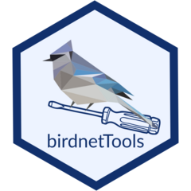

<!-- README.md is generated from README.Rmd. Please edit that file -->

```{r, include = FALSE}
knitr::opts_chunk$set(
  collapse = TRUE,
  comment = "#>",
  fig.path = "man/figures/README-",
  out.width = "100%"
)
```

# birdnetTools <a href="https://birdnet-team.github.io/birdnetTools/"></a>

<!-- badges: start -->

[](https://github.com/birdnet-team/birdnetTools/actions/workflows/R-CMD-check.yaml) [](https://app.codecov.io/gh/birdnet-team/birdnetTools) [](https://lifecycle.r-lib.org/articles/stages.html#experimental)

<!-- badges: end -->

The `birdnetTools` is an R package designed to streamline the post-processing and validation of output from BirdNET, an open-source neural network developed by the [Cornell Lab of Ornithology](https://www.birds.cornell.edu/home/) and [Chemnitz University of Technology](https://www.tu-chemnitz.de/index.html.en) for detecting and identifying bird sounds. The goal of `birdnetTools` is to help researchers manage, explore, and validate BirdNET results. It includes functions for filtering detections by species, confidence, and date/time; visualizing temporal patterns; and validating detections with an interactive Shiny app to support threshold-setting workflows.

A cheatsheet showing the `birdnetTools` workflow can be found [here](https://github.com/birdnet-team/birdnetTools/blob/master/man/figures/workflow.png).

## Installation

You can install the development version of birdnetTools from GitHub with:

``` r
# install.packages("pak")
pak::pak("birdnet-team/birdnetTools")
```

## Example use

Below is a quick example using the built-in dataset `example_jprf_2023`, which contains detections recorded from five ARUs in northern British Columbia. We'll filter detections for Swainson’s Thrush, visualize detection patterns, and calculate a species-specific threshold from simulated validation data.

```{r example, fig.width=8, fig.align='center', out.width='100%'}
library(birdnetTools)

# Load built-in dataset
data <- example_jprf_2023


# Filter for Swainson's Thrush detections during spring
data_filtered <- birdnet_filter(data,
                                species = "Swainson's Thrush",
                                threshold = 0.2,
                                year = 2023,
                                min_date = "2023-05-01",
                                max_date = "2023-06-30")


# Visualize daily detection patterns across sites
birdnet_heatmap(data_filtered)

```

```{r}
# Simulate validation (for demonstration only)
set.seed(123)
data_sub <- birdnet_subsample(data_filtered, n = 300)

data_sub$validation <- rbinom(nrow(data_sub), 1, 
                              prob = pmin(pmax(data_sub$confidence, 0), 1))


# Calculate species-specific threshold for 90% precision
birdnet_calc_threshold(data_sub, precision = 0.9)
```

## Contributing and support

Contributions are welcome. Please see the [contributing guidelines](.github/CONTRIBUTING.md) for how to report bugs, suggest features, and submit pull requests.

- **Questions or help using the package:** see [SUPPORT.md](.github/SUPPORT.md).
- **Bug reports and feature requests:** open an [issue](https://github.com/birdnet-team/birdnetTools/issues) and use the [template](.github/ISSUE_TEMPLATE/issue_template.md) provided.
- **Code of conduct:** please note that this project is released with a [Contributor Code of Conduct](.github/CODE_OF_CONDUCT.md). By contributing to this project, you agree to abide by its terms.


## `birdnetTools` funding

The development of `birdnetTools` is part of a visiting scholar program supported by the [Michael Smith Foreign Study Supplements](https://www.nserc-crsng.gc.ca/Students-Etudiants/PG-CS/CGSForeignStudy-BESCEtudeEtranger_eng.asp), funded by the Natural Sciences and Engineering Research Council of Canada (NSERC). I’m incredibly fortunate to have received this support, which allowed me to collaborate in person with the BirdNET team in Chemnitz, Germany.

The occupancy modelling part of development is further supported by an [R Consortium](https://r-consortium.org/) Infrastructure Steering Committee (ISC) grant (grant number 25-ISC-2-03), for the project "[birdnetTools 2.0: Linking BirdNET outputs to occupancy modeling in R](https://r-consortium.org/all-projects/2025-group-2.html#birdnettools-20-linking-birdnet-outputs-to-occupancy-modeling-in-r)". 


## BirdNET funding

BirdNET is supported by Jake Holshuh (Cornell class of '69) and The Arthur Vining Davis Foundations. Our work in the K. Lisa Yang Center for Conservation Bioacoustics is made possible by the generosity of K. Lisa Yang to advance innovative conservation technologies to inspire and inform the conservation of wildlife and habitats.

The development of BirdNET is supported by the German Federal Ministry of Education and Research through the project “BirdNET+” (FKZ 01\|S22072). The German Federal Ministry for the Environment, Nature Conservation and Nuclear Safety contributes through the “DeepBirdDetect” project (FKZ 67KI31040E). In addition, the Deutsche Bundesstiftung Umwelt supports BirdNET through the project “RangerSound” (project 39263/01).

## Partners

BirdNET is a joint effort of partners from academia and industry. Without these partnerships, this project would not have been possible. Thank you!


