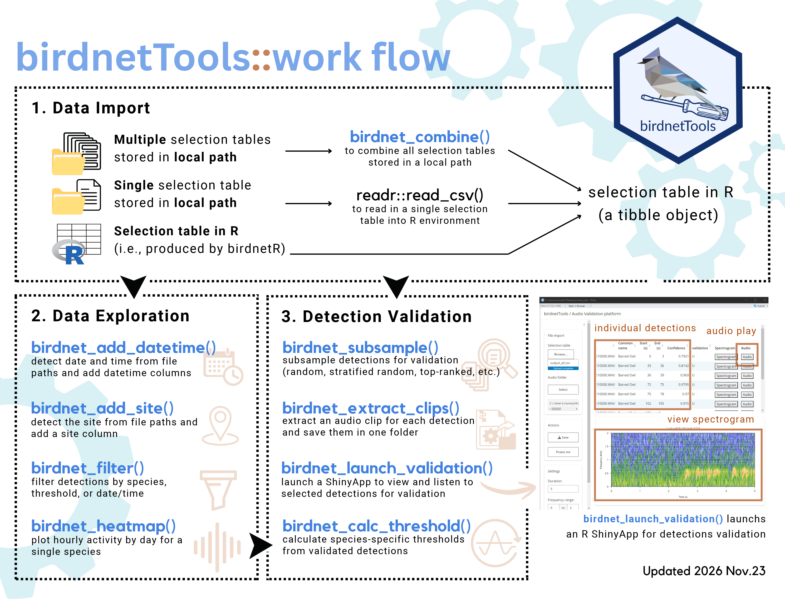
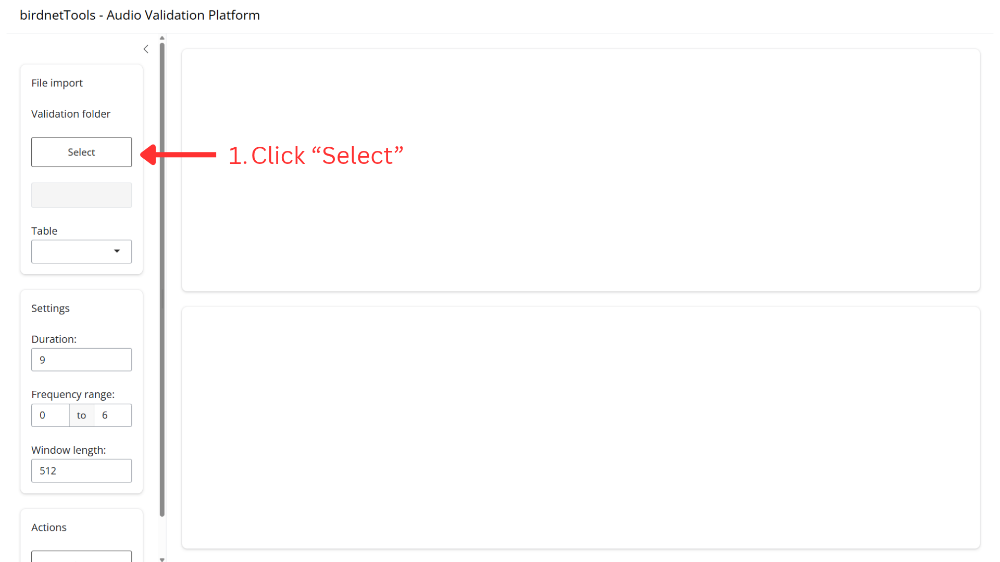
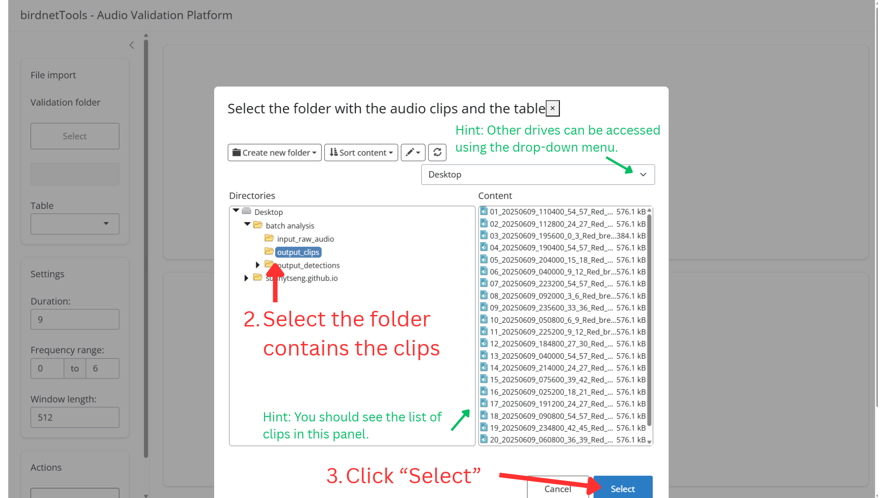
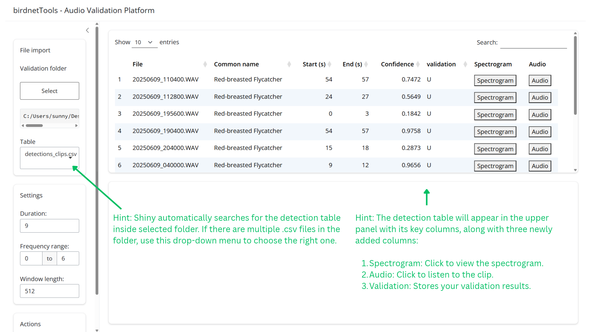
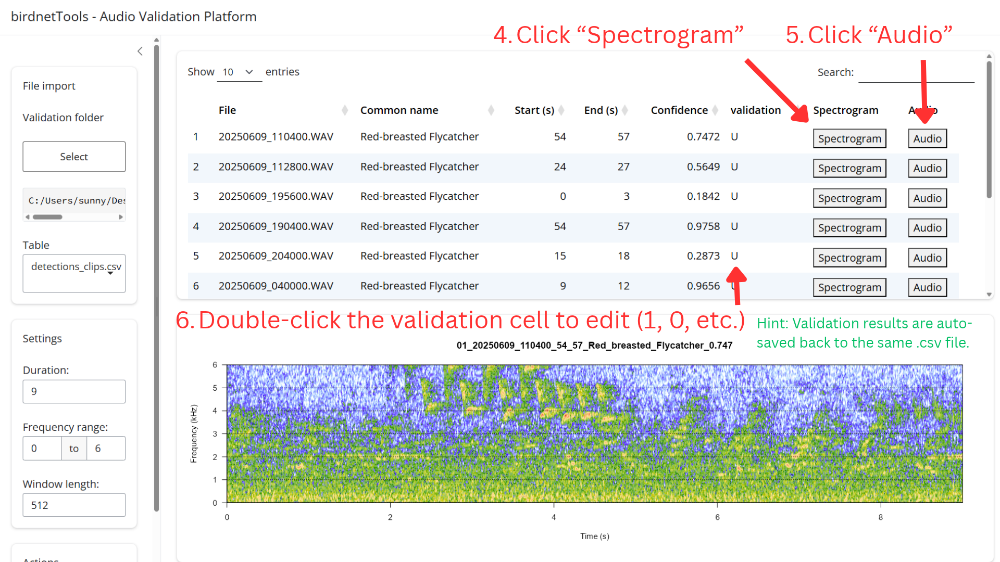

```{r, include = FALSE}
knitr::opts_chunk$set(
  collapse = TRUE,
  comment = "#>"
)
```

```{r setup}
library(birdnetTools)
```


The `birdnetTools` is an R package designed to streamline the post-processing and validation of output from BirdNET, an open-source neural network developed by the [Cornell Lab of Ornithology](https://www.birds.cornell.edu/home/) and [Chemnitz University of Technology](https://www.tu-chemnitz.de/index.html.en) for detecting and identifying bird sounds. The goal of `birdnetTools` is to help researchers manage, explore, and validate BirdNET results. It includes functions for filtering detections by species, confidence, and date/time; visualizing temporal patterns; and validating detections with an interactive Shiny app to support threshold-setting workflows.


The cheatsheet below can be downloaded from [here](https://github.com/birdnet-team/birdnetTools/blob/master/man/figures/workflow.png):




## Data Import

BirdNET detections can be imported in various formats depending on how your data was processed and saved. The `birdnetTools` package supports three main workflows:

1. Importing multiple detection results

After processing audio files through BirdNET, you may have several `.csv` files—each corresponding to a separate recording. The `birdnet_combine()` function allows you to import and merge these files into R all at once. It reads all `.csv` files in a specified directory, combines them into a single data frame, and adds a `filepath` column if it's not already present.

This is especially useful when you've processed large batches of audio recordings and want to work with them collectively in R.

```{r eval = FALSE}
# import multiple detection files
birdnet_combine(path = "PATH_TO_BIDNET_OUTPUT_FOLDER")
```


2. Importing combined detection results

If you already have a combined output file, for example, if you checked the "combine output table" option in the BirdNET GUI, you can read it directly into R using the `readr` package:

```{r eval = FALSE}
# Import a combined detection CSV
library(readr)
detections <- read_csv("PATH_TO_BIRDNET_OUTPUT_FILE.csv")
```


3. Using detection results already in R

Another possibility is that you analyzed the audio files using the [`birdnetR`](https://github.com/birdnet-team/birdnetR) package, which by default returns a data frame containing BirdNET detections. In this case, you can use the data frame directly in your analysis without needing to import it again. The functions in `birdnetTools` are designed to work with data frames that include the necessary columns: `start`, `end`, `common_name`, `confidence`, and `filepath`.


## Exploring and Preparing Data

To demonstrate how the functions in `birdnetTools` work, we will use the built-in dataset `example_jprf_2023`. This dataset contains BirdNET detections recorded at the John Prince Research Forest in British Columbia, Canada, over a continuous 24-hour period during May–June 2023, from 5 ARU locations. The recordings were processed using the BirdNET GUI (model v2.4) with a confidence threshold of 0.1. The dataset contains 392,300 rows and 14 columns, including information such as the file path, start and end times of detections, species names, and confidence scores.


```{r}
# load the dataset
data <- example_jprf_2023

# view the dataset documentation
?example_jprf_2023
```


### Filtering data with customized criteria

In most cases, researchers don’t work directly with the full set of raw BirdNET detections. Instead, they may be interested in filtering for specific specie(s), applying a confidence threshold, narrowing the dataset by date, or selecting recordings from certain hours of the day. The `birdnet_filter()` function makes it easy to apply these filters in a single step:

```{r}
# apply filter
data_filtered <- birdnet_filter(data,
                                species = "Swainson's Thrush",
                                threshold = 0.2,
                                year = 2023,
                                min_date = "2023-05-01",
                                max_date = "2023-06-30",
                                hour = c(0:23)
)

# view function documentation
?birdnet_filter()
```

The `birdnet_filter()` function allows you to filter BirdNET detections based on a variety of criteria, including species, confidence threshold, year, date range, and hour of the day. The `species` argument should be specified using common names, either as a single character string or a vector of names. The `threshold` argument accepts either a numeric value (for a universal threshold) or a data frame containing `common_name` and `threshold` columns (for species-specific thresholds); detections with confidence scores below the specified threshold will be excluded. The `year` and `hour` arguments can also be given as single values or vectors.

After applying filters using `birdnet_filter()`, the function automatically records the filtering criteria in the data's attributes. This makes it easy to keep track of how the dataset was processed:

```{r}
attr(data_filtered, "filter_log")
```


<!-- You can also choose to use individual filtering functions. These include filters by species, threshold, year, date range, and hour. The `birdnet_filter()` function serves as a convenient wrapper that combines all of these helper functions. -->
<!-- ```{r} -->
<!-- # detection for kinglets -->
<!-- data_kinglet <- birdnet_filter_species( -->
<!--   data,  -->
<!--   c("Golden-crowned Kinglet", "Ruby-crowned Kinglet") -->
<!--   ) -->
<!-- ``` -->

<!-- ```{r} -->
<!-- # detection with confidence above 0.85 -->
<!-- data_0.85 <- birdnet_filter_threshold(data, 0.85) -->
<!-- ``` -->

<!-- ```{r} -->
<!-- # detection in 2023 -->
<!-- data_2023 <- birdnet_filter_year(data, 2023) -->
<!-- ``` -->

<!-- ```{r} -->
<!-- # detection on May 2023 -->
<!-- data_may <- birdnet_filter_date_range(data,  -->
<!--                                       min_date = "2023-05-01",  -->
<!--                                       max_date = "2023-05-31") -->
<!-- ``` -->

<!-- ```{r} -->
<!-- # detection in the morning (4am to 7am) -->
<!-- data_morning <- birdnet_filter_hour(data, c(4:7)) -->
<!-- ``` -->


### Visualizing raw/filtered data

Visualization is the easiest way to quickly examine the data, identify any obvious outliers, assess detection distributions, and observe patterns. The `birdnet_heatmap()` function provides this type of visualization and can be used with either raw or filtered data. Below is an example of the activity pattern of Swainson's Thrushe across the breeding season (across 5 ARU sites). 

```{r fig.width=8, fig.align='center', out.width='100%'}
birdnet_heatmap(data_filtered)
```

> Note: If you visualize raw data (before filtering species and site), detections will be grouped across all species and locations — interpret with caution.


### Add columns for date and time

Often, it is necessary to have datetime information associated with the detections to know exactly when the detections were made (i.e., when the bird was singing). The `birdnet_add_datetime()` adds this datetime information to your data. This function requires the original dataset to include datetime details within the file path column. It scans the file path for datetime patterns and extracts the date (year, month, day) and time (hour, minute).

```{r}
# add datetime information to the filtered data
data_with_datetime <- birdnet_add_datetime(data_filtered)

# show which new columns were added
new_columns <- setdiff(colnames(data_with_datetime), colnames(data_filtered))
new_columns
```


## Validating Detections

Each BirdNET detection includes a "confidence" score, but this score does not reflect true probability and varies in meaning across species. For example, BirdNET may detect one species reliably even at low confidence, while another may still yield false positives at high confidence. To improve reliability, it’s recommended to use species-specific thresholds. This section follows the methods outlined in [Tseng et al. 2025](https://link.springer.com/article/10.1007/s10336-025-02260-w), which require a validation process where a subset of detections is reviewed by human experts to classify them as true or false positives. For further context on interpreting confidence scores, see [Wood and Kahl 2024](https://link.springer.com/article/10.1007/s10336-024-02144-5).

The workflow has four steps:

1. **Subsample** the detections to validate with `birdnet_subsample()`.
2. **Extract** a short audio clip for each of them into one folder with `birdnet_extract_clips()`.
3. **Validate** the clips in a Shiny app launched by `birdnet_launch_validation()`.
4. **Calculate** a species-specific threshold with `birdnet_calc_threshold()`.


### 1. Get a validation set by subsampling

To get the species-specific threshold, we will need to validate detections in `data_filtered`, which contains Swainson’s Thrush detections filtered at a 0.2 confidence threshold. First, we will need to subsample a portion for manual review. The `birdnet_subsample()` function draws `n` detections in total from the data you give it, using one of four methods:

- `even_stratified` (the default): samples evenly across confidence score bins, so detections from the whole range of confidence scores are covered.
- `proportional_stratified`: samples across confidence score bins in proportion to how many detections each bin contains.
- `random`: a simple random sample.
- `top`: the detections with the highest confidence.

```{r}
# subsample 300 detections from the filtered data
data_subsampled <- birdnet_subsample(data_filtered,
                                     n = 300,
                                     seed = 123) # for reproducibility

# view function documentation
?birdnet_subsample()
```


Optionally, you can also save the subsampled detections as a `.csv` file by setting `save_to_file = TRUE` and specifying a file name. This is not needed for the next step, which saves the table together with the clips.


```{r eval=FALSE}
birdnet_subsample(
  data_filtered,
  n = 300,
  save_to_file = TRUE, # whether to save the subsample to a file
  file = "swainsons_thrush_validation.csv" # name of the file
)
```


### 2. Extract the audio clips

Validating detections directly from the full recordings means locating each file and finding the right timestamp. A validation set is only a small part of the full data set (for example, 300 three-second segments out of terabytes of audio), so it is easier to cut those segments into a folder of their own first. The clips open instantly in the app, the folder can be zipped and sent to a collaborator or archived with a paper without the original recordings, and the app never has to deal with file paths that went stale when drives changed.

The `birdnet_extract_clips()` function takes the subsampled detections and cuts one clip for each of them:

```{r eval=FALSE}
birdnet_extract_clips(
  data = data_subsampled,
  output_dir = "path/to/validation_folder", # where the clips and the table are saved
  audio_dir = "path/to/recordings",         # where the original recordings are
  buffer = 3                                # seconds added before and after each detection
)

#> ✔ Extracted 300 of 300 clips to path/to/validation_folder.
#> ✔ Saved the table to path/to/validation_folder/detections_clips.csv.
```


Replace the two paths with your own folders. The validation folder then looks like this (the exact file names will differ):

```
validation_folder/
├── detections_clips.csv
├── 001_20230611_054000_45_48_Swainson_s_Thrush_0.715.WAV
├── 002_20230611_032500_15_18_Swainson_s_Thrush_0.575.WAV
└── ...
```

### 3. Validation using shinyApp

Manually validating detections, by locating audio files, finding timestamps, and listening to clips, can be slow and tedious. The `birdnet_launch_validation()` function streamlines this process by launching a Shiny app that displays the detections alongside their spectrograms and corresponding audio clips. With an interactive interface, users can quickly review each detection by listening to audio or viewing spectrograms and edit the validation datasheet, making the validation process much more efficient.

```{r eval=FALSE}
birdnet_launch_validation()
```

After running the code above, a Shiny interface will launch. The app needs just one input, the validation folder created in step 2.

1. Click **Select** under "Validation folder".

    

2. Navigate to your validation folder, select it, and click **Select**. The app reads the table and displays it in the top panel.

    

    If the folder contains more than one `.csv` table, choose the one to validate from the **Table** dropdown.

    

3. Click **Spectrogram** to show the spectrogram of a detection below the table, or **Audio** to play the clip.

4. Double-click the `U` (Unknown, the default) cell in the `validation` column, and enter `1` for a true positive or `0` for a false positive. Your edits are saved automatically to the table in the validation folder, so there is no Save button.

    

**Other hints:**

- You can close the app at any time and pick up where you left off by selecting the same folder and table again. If you want to keep an unvalidated copy of the table, make one before you start.

- The **Settings** panel lets you change what is shown: the duration of the window around each detection (it can't be longer than the clip), the frequency range, and the window length of the spectrogram.

- And if you're getting tired, try the **Praise me** button for a quick boost of motivation. 🌟

> Note: You can also put a validation folder together yourself, with a table (`.csv`) and the audio. If the table has `clip_file` and `clip_start` columns, as the table made by `birdnet_extract_clips()` does, the app plays the clips listed there. Otherwise, it looks for each recording by the file name in the `filepath` column, in the folder and its subfolders, and plays the detection at its start and end times. This is slower for long recordings.


### 4. Get threshold 

Once a set of BirdNET detections has been validated (i.e., manually labeled as true or false positives), you can calculate a species-specific confidence threshold that meets a desired level of precision. The `birdnet_calc_threshold()` function helps identify the minimum confidence score required to achieve a target precision for a given species.

The validated table is the `detections_clips.csv` file in your validation folder, which now has the `validation` column filled in. Read it back into R, making sure that no `U` is left in the `validation` column:

```{r eval=FALSE}
data_validated <- readr::read_csv("path/to/validation_folder/detections_clips.csv")
```


To demonstrate the next step without a real validation, we simulate one by treating each detection as a Bernoulli trial, where the probability of a true positive equals the confidence score:

```{r}
# simulate validation as a Bernoulli trial
data_subsampled$validation <- rbinom(
  n = nrow(data_subsampled), 
  size = 1, 
  prob = pmin(pmax(data_subsampled$confidence, 0), 1)
)

```

It only takes one line of code to calculate species-specific thresholds using the `birdnet_calc_threshold()` function. This function requires a data frame containing the columns `common_name`, `confidence`, and `validation` (where validation is `1` for true positives and `0` for false positives). It returns the minimum confidence score needed to achieve the specified precision or probability level. For more details on the difference between the precision and probability arguments, please see the function documentation (`?birdnet_calc_threshold()`).


```{r}
birdnet_calc_threshold(data_subsampled,
                       precision = 0.9)
```


> Note: To demonstrate this function, we use a simulated validation dataset included in the package. This dataset mimics what a real validation file might look like, but it is not derived from actual expert-reviewed audio.

